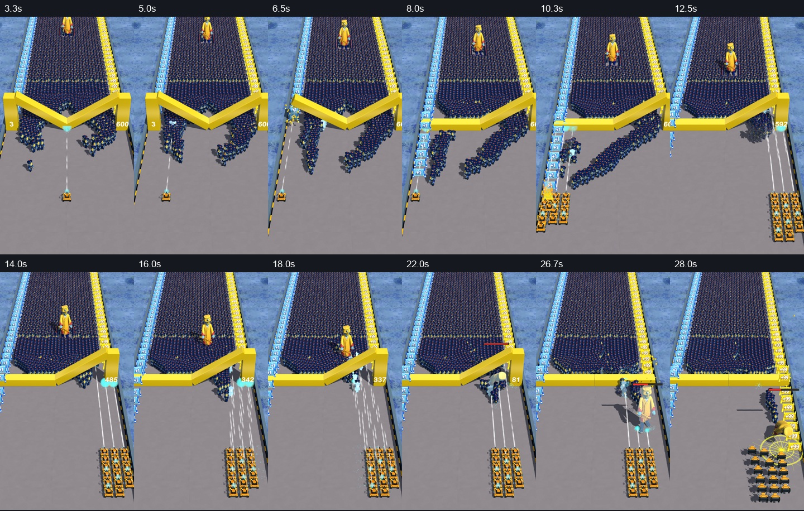

# 守桥尸潮 · Tuanjie Horde Reconstruction

一个用**团结引擎（Tuanjie）**重建“守桥尸潮”广告玩法的可编辑工程。项目把三列队伍、数字门、可破坏金梁、单向弹道、近景物理尸潮、远景实例化尸潮和 Boss 追击串成一段 31 秒的可重复演示，用于玩法验证、镜头/事件对齐和后续美术替换。

> **当前仓库定位**：这是可继续编辑的玩法重建工程，不是原片的逐像素复制。角色、环境和部分特效仍包含占位或近似资产；音频为按事件重排的混合音轨。仓库为私有项目，使用其中的第三方素材时请遵守对应授权。



## 你会在这里看到什么

- `TuanjieHorde_QualitySample/`：当前推荐打开的主工程，包含 `Assets`、`Packages` 和 `ProjectSettings`。
- `Assets/Scenes/BridgeHorde.unity`：主场景。
- `Assets/Scripts/`：队列移动、数字门、金梁倒塌、弹道、敌人、Boss 和特效逻辑。
- `Assets/Settings/ModelReplacements.asset`：Starter、Upgraded、Zombie、Boss 的可替换模型入口。
- `docs/quality-v4.md`：完整修订版 04 的制作与验收说明。
- `docs/verification-full-hd60.json`：31 秒、1080×1920、60 fps 录制的结构化核验结果。

仓库刻意不提交 Unity/Tuanjie 的导入缓存、构建目录、运行日志、试玩包、视频和本地工具。它们可以从当前工作区重新生成，也会让 GitHub 仓库膨胀到难以克隆。

## 快速开始

1. 安装团结引擎 **2022.3.62t14（1.10.2）**。
2. 克隆仓库后，用团结 Hub/编辑器打开 `TuanjieHorde_QualitySample/`。
3. 打开 `Assets/Scenes/BridgeHorde.unity`，点击 Play。
4. 如果需要生成交付视频或试玩包，请在本机重新执行构建；构建输出默认位于被 `.gitignore` 忽略的 `Build/` 目录。

Windows 下也可以双击 `TuanjieHorde_QualitySample/打开团结工程.cmd`，前提是本机已安装对应版本的团结编辑器并已加入 PATH 或配置好启动方式。

## 演示操作

试玩/录制逻辑使用固定事件时间线，便于复现和对比：

- `Tab`：切换手动视角/控制模式
- `A` / `D`：左右移动
- `Space`：暂停/继续
- `R`：重播

## 核心玩法实现

- **队伍与数字门**：队伍按三列前进，消耗 `+1` 门补充成员；`+99` 门在本版中保持未消耗。
- **金梁与道路**：两侧金梁按确定轨迹倒塌，落地后形成水平障碍并触发道路连通事件；碰撞和视觉轨迹分离，保证演示可重复。
- **弹道与命中**：子弹沿世界 `+Z` 前进，只处理首次接触；普通弹和强化冰弹使用真实前向碰撞，不按发光范围扩大碰撞体。
- **尸潮性能**：近处交互使用物理对象，远处尸潮使用实例化网格；死亡对象回收复用，避免持续分配。
- **Boss 流程**：Boss 从右侧通道通过横梁，追向实际队伍位置，蓄力后完成重击与败退事件。
- **模型替换**：替换 Prefab 时保持脚底为原点、正方向为 `+Z`，枪口节点命名为 `Muzzle`；Animator 可使用 `Speed`、`MoveX`、`Attack`、`Duck`、`Fire`、`Death` 参数。

## 已记录的验证结果

完整修订版 04 的核验记录包括：

- 31 秒，1080×1920，60 fps，共 1860 帧；
- 弹道/追击/支撑检查 16 项通过，0 项失败；
- 真实前向弹道、单弹单次首接触、单弹单次直接伤害；
- `+1` 门消耗 16 次，`+99` 门消耗 0 次；
- 两侧道路连通，Boss 蓄力、重击和败退事件均出现；
- 支撑姿态检查 482 个，最大横梁接点误差约 `6.6e-7`。

这些数字来自结构化验证文件和录制检查，代表当前交付样本的验证结果，不等同于所有设备上的性能保证。主观听音验收仍未完成。

## 目录结构

```text
.
├─ TuanjieHorde_QualitySample/
│  ├─ Assets/
│  ├─ Packages/
│  ├─ ProjectSettings/
│  └─ 本版说明.md
├─ docs/
│  ├─ quality-v4.md
│  ├─ verification-full-hd60.json
│  └─ media/
├─ .gitignore
└─ README.md
```

## 状态与后续方向

当前版本适合作为玩法和镜头基线，下一步通常是替换角色/环境模型、补齐远景对应网格、完善材质与粒子细节，并在目标设备上重新做构建、帧率和主观听音验收。历史版本、备份和本地生成产物仍保留在原工作区，但不作为仓库的默认源码入口。

## License

本仓库暂未发布开源许可证，默认仅供授权团队内部使用。原始参考素材、导入模型、音频片段和团结引擎本身分别受其各自许可约束。
